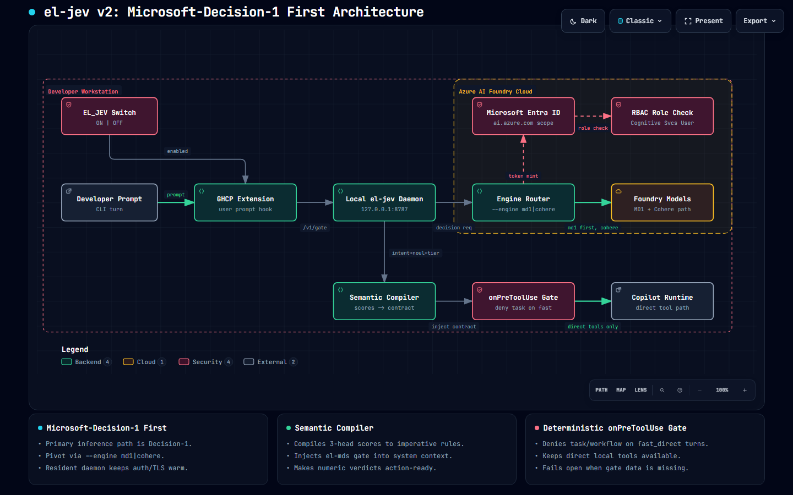
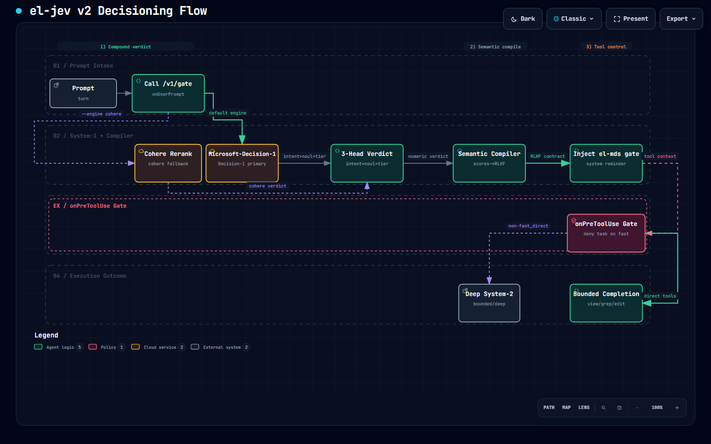

# el-jev v2 Architecture — Microsoft-Decision-1 + Semantic Compiler + Tool Gate

`el-jev v2` is a System-1 control plane for Copilot CLI that is **Microsoft-Decision-1-first** and designed to produce enforceable execution behavior, not just advisory tags.

It combines:

1. **3-head System-1 verdict** from `md1` (`intent`, `needs_deep_analysis`, `execution_tier`),
2. **Semantic Compiler** that translates numeric outputs into imperative RLHF-native constraints,
3. **Deterministic `onPreToolUse` gate** that blocks expensive sub-agent tools on enforceable fast turns.

## Service Boundary (MD1-first dual-engine path)

```text
GHCP Extension (el-mds) / Hook     CLI (el-mds / eljev) / MCP / Custom App
              \                                       /
               ------> local el-jev daemon (:8787) <--
                                   |
                         --engine md1 | cohere
                        /                     \
     Foundry Microsoft-Decision-1 (MD1)     Foundry Cohere Rerank v4.0 Pro
     (/providers/microsoft/v1/systemone)     (/providers/cohere/v2/rerank)
```

---

## Topology





- 🌐 [Interactive architecture](architecture.html)
- 🌐 [Interactive decisioning flow](decisioning-flow.html)

---

## v2 Ground-Up Flow

### Stage 1 — Microsoft-Decision-1 3-head verdict (`/v1/gate`)

`eljev/engines/md1.py` issues one batched pass to Decision-1 and returns:

- `intent` (`choice`)
- `needs_deep_analysis` (`noul`)
- `execution_tier` (`fast_direct` | `bounded_work` | `deep_system2`)

This separates simple bounded turns from complex turns in ~single-pass latency.

### Stage 2 — Semantic Compiler (probabilities → imperative contract)

Raw probabilities are not exposed as unlabeled machine hints.  
Instead, `_budget_text(...)` compiles gate output into explicit execution contract text:

```text
[el-mds gate]
tier: fast_direct | intent: review_audit | needs_deep_analysis: 0.005 | mode: advisory (needs_review)
directive: EXECUTION CONTRACT (bounded review_audit task): Execute directly without extended deliberation. Do NOT write an upfront multi-step plan. Do NOT spawn sub-agents (do not call task or run_dynamic_workflow). Complete using at most 3 direct tool calls (view, grep, edit, powershell) and reply in 3 sentences or fewer.
[/el-mds gate]
```

This contract is injected through harness system context (`additionalContext` / `<system_reminder>`), which instruction-tuned models already prioritize.

### Stage 3 — Deterministic harness circuit-breaker (`onPreToolUse`)

When the gate is enforceable and tier is `fast_direct`, the extension denies:

- `task`
- `run_dynamic_workflow`

This prevents accidental escalation into expensive sub-agent trees for bounded work.

---

## Why v2 is different from v1 advisory tags

v1 emitted advisory blocks such as:

```text
[el-jev advisory]
kind: choice | decision: review_audit | confidence: 0.70 | margin: 0.58
gate: needs_review (exit 2) -> treat as a hint; reason normally
probabilities: review_audit=0.698, investigation_search=0.117, code_modification=0.086
[/el-jev advisory]
```

That failed as behavioral control because:

1. The tag syntax is project-local and unknown to base models.
2. The line `"treat as a hint; reason normally"` actively invites full System-2 reasoning.
3. Intent labels do not encode budget constraints.

v2 solves this by compiling to imperative constraints and adding deterministic enforcement.

---

## Runtime Components

| Component | Role |
|---|---|
| `eljev/engines/md1.py` | Decision-1 client, shape adapters, gate composer, semantic compiler output |
| `eljev/daemon.py` | Resident local daemon for warm auth/TLS and normalized decision envelopes |
| `.github/extensions/el-mds/extension.mjs` | Harness integration (`onUserPromptSubmitted`, `onPreToolUse`) |
| `hooks/eljev_pre_turn.py` | Compatibility hook path and advisory fallback surface |

---

## Engine Pivot (`--engine md1|cohere`)

- `md1`: Microsoft-Decision-1-first typed decisioning and 3-head gate composition.
- `cohere`: Cohere rerank path for typed choices/screening.

Both map into the same contract-aware decision/gate envelope so policy code remains stable.

---

## Operational Characteristics

- Local daemon loopback: `127.0.0.1:8787`
- Fail-open policy on unavailable gate responses (no hard user-turn breakage)
- Loopback hardening and JSON contract validation
- Deterministic denial only at tool boundary (`onPreToolUse`) for enforceable fast-tier turns

---

## Benchmarks (local measured)

| System | Median | p95 |
|---|---:|---:|
| `el-jev` warm decision path | 183 ms | 351 ms |
| task sub-agent decisioning baseline | 3.84 s | 5.76 s |
| general-purpose sub-agent baseline | 5.12 s | 10.48 s |

Speedup is largest when `el-jev` replaces LLM routing and prevents unnecessary delegation.
